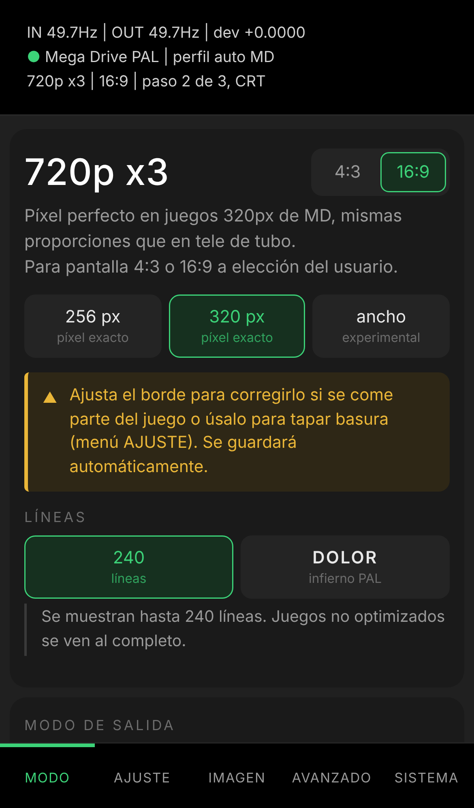
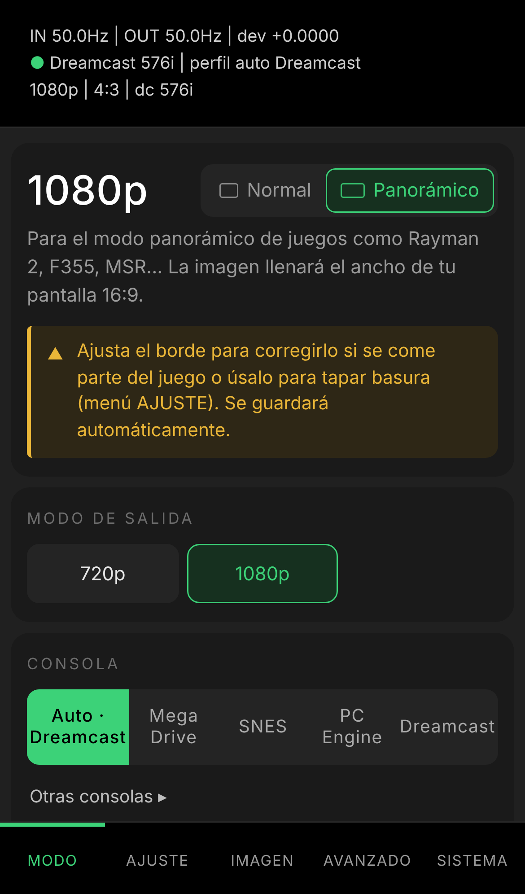
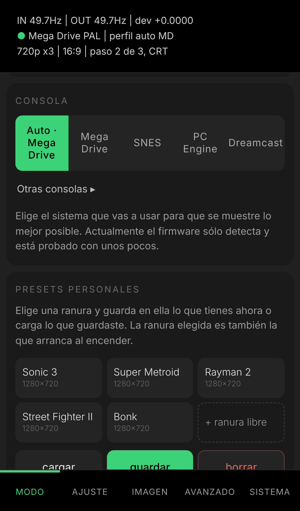
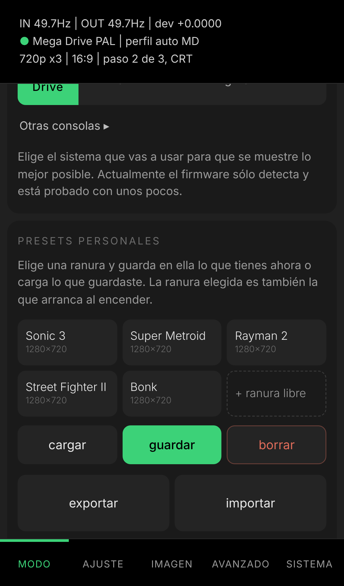
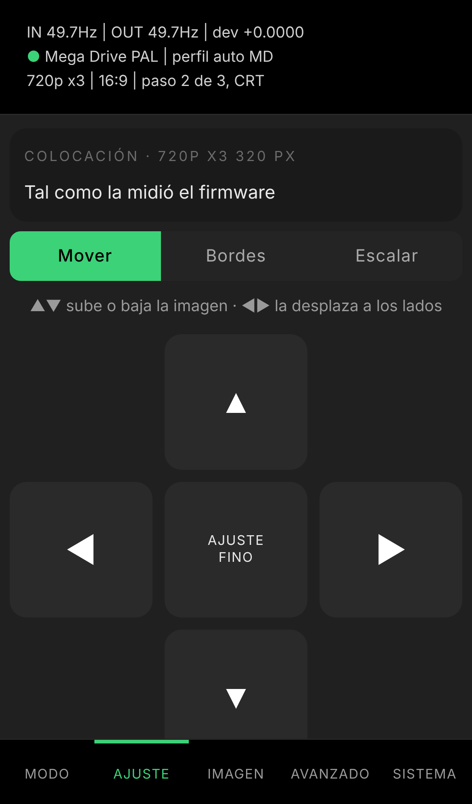
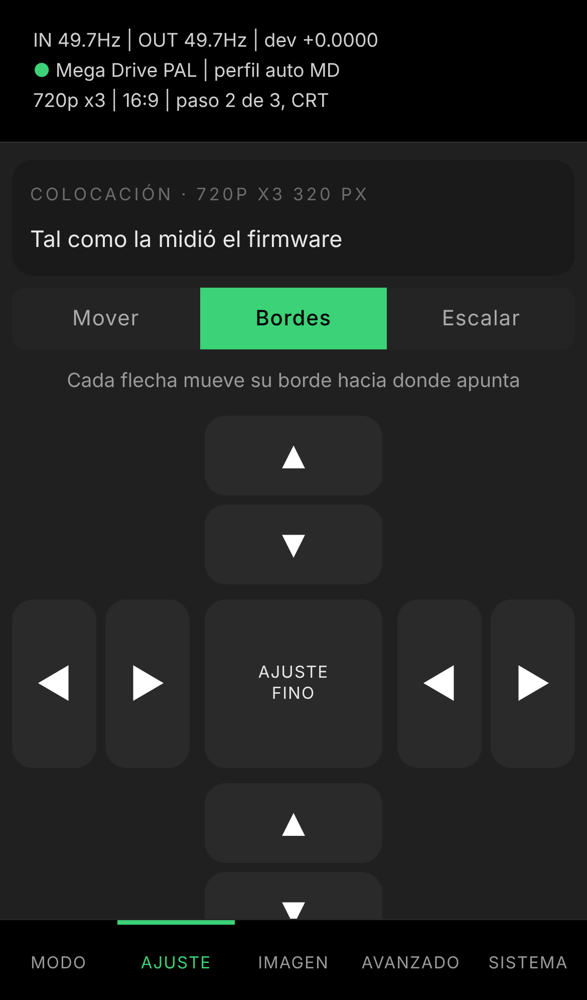
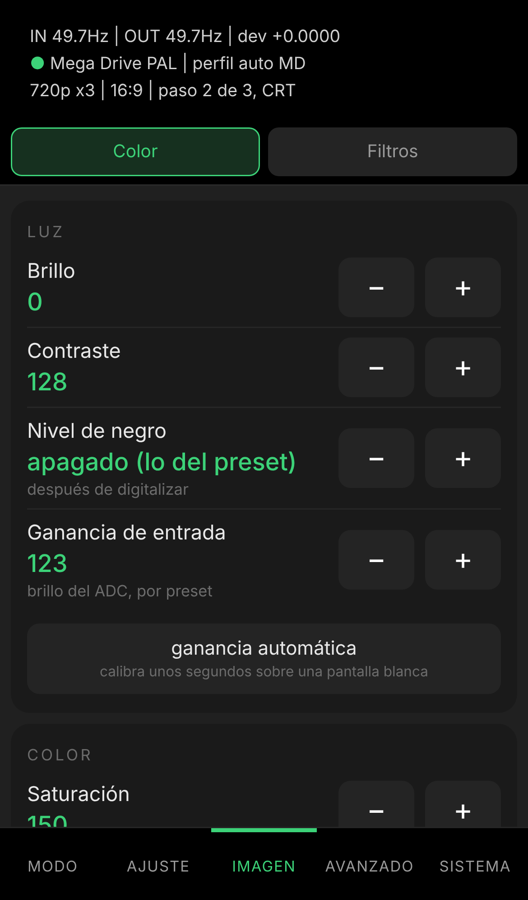
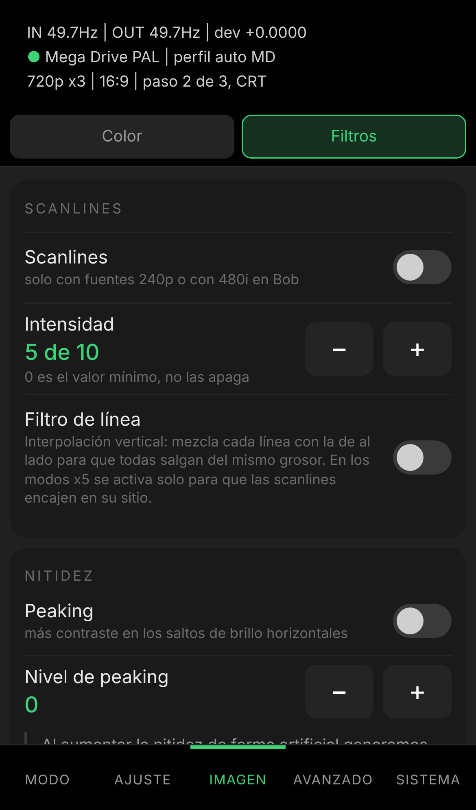
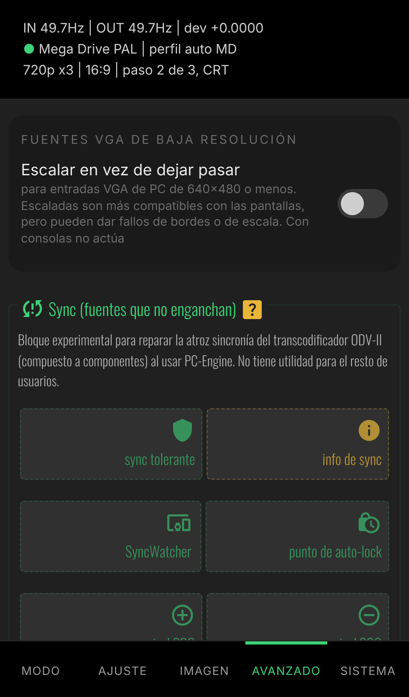

[Español](README.md) | **English**

Translation done entirely with AI to speed up the work. Sorry, friends, this takes up too much of my time. Thanks for understanding.

# gbs-control-3X4X
<b>GBS-Control firmware with automatic console detection, integer pixels and perfect vertical scaling without touching a thing.</b> 
  <i>Switch on, set it up once and play.</i>

<table align="center">
  <tr>
    <td></td>
    <td></td>
    <td></td>
  </tr>
  <tr>
    <td></td>
    <td></td>
    <td></td>
  </tr>
  <tr>
    <td></td>
    <td></td>
    <td></td>
  </tr>
</table>

## Contents

- [Firmware goals](#firmware-goals)
- [Very important](#very-important)
- [Installing with Visual Studio Code](#installing-with-visual-studio-code)
- [About the experimental modes](#about-the-experimental-modes)
- [WHAT'S NEW IN 3X4X](#whats-new-in-3x4x)
- [Experimental method for very difficult sync (ODV-II)](#experimental-method-for-very-difficult-sync-odv-ii)
- [Hardware tested so far, with its own profile](#hardware-tested-so-far-with-its-own-profile)
- [How to help add new systems](#how-to-help-add-new-systems)
- [Credits](#credits)

## Firmware goals

The main goal of this firmware is to detect the connected console and load its profile automatically, without any user intervention, providing vertical scaling and integer pixel settings without touching a thing. This means you can switch on, set it up once and play, and it will remember your settings for each system the next time it is detected. As simple as our 90s consoles, right? Still, it is an ambitious goal that may be impossible to reach 100% in every scenario.

The firmware can currently recognise Mega Drive JAP (60 Hz), Mega Drive PAL (at 50 Hz or 60 Hz), Super Nintendo PAL (at 50 Hz or 60 Hz), Dreamcast PAL and PC-Engine (experimental*). To increase the number of systems I will need help from other GBS-Control users. More information below.

\* My PC-Engine is not modded for RGB; it has only been tested through a very troublesome ODV-II (composite to component transcoder). More information further down.

The second key goal for me was being able to switch between integer and perfect pixels, or play with proportions similar to how we played back then. You know what I mean: the eternal debate over whether a Super Nintendo should be played in the 4:3 format of an old TV, or whether it is better to respect its integer pixels at 8:7. Let everyone choose what they like, right? You just press a button, no maths needed: it is written into the firmware.

The third goal was playing at 1080p in anamorphic widescreen. Consoles from the so-called 128-bit generation have quite a few games with a widescreen mode, and even the Dreamcast has a handful, like Rayman 2, F355, Metropolis Street Racer... The two video modes I have focused on (more in the future, God willing), the usual 720p and 1080p, now let you play in 4:3 or fill the whole screen.

The fourth essential goal was being able to import and export custom presets. You can now share all your favourite settings with your friends in just a couple of taps, including the colour profiles for each console.

And a fresh new look. Well, and a few more things, but let's not drag this introduction out forever.

## Very important

The 3X4X firmware is a variant of Rama's [gbs-control](https://github.com/ramapcsx2/gbs-control) firmware, but it is based on Kwakx's gbs-control-nx. I found it interesting to start from there because its author focused on improving Wi-Fi stability, one of the best-remembered historical problems of this device. Even so, the only thing that really works for me is moving my wireless network to channel 11. One example is the sampling clock I use in the Dreamcast "1080p 16:9 VGA" mode: it is hell for the Wi-Fi, and if I am not on channel 11 it is completely knocked out.

I cannot guarantee this firmware works on GBS-Control builds other than mine: GBS-8200, ESP8266 and Si5351 clock. It makes no difference if you describe your scaler's hardware in detail, or if it is a redesigned Chinese variant on a better PCB than mine. I don't know, because I can't test it: I have what I have. You can see my GBS-Control in my YouTube video about building it: [https://www.youtube.com/watch?v=-gFRIrJZsR8](https://www.youtube.com/watch?v=-gFRIrJZsR8)

That video is old and probably outdated; I have learned quite a few new things since then.

This firmware is installed with Visual Studio Code or from the Update section of the web interface (only if your firmware already supported this feature). I can't detail the installation steps any further right now; search the internet for how to install a PlatformIO project or ask an AI for help.

## Installing with Visual Studio Code

1. **Install Visual Studio Code** (code.visualstudio.com) and, inside it, the **PlatformIO IDE** extension from the extensions panel (the four-squares icon on the left bar). When it finishes, restart Visual Studio Code.
2. **Download the project:** on this GitHub page, green "Code" button › "Download ZIP". Unzip it into a folder whose path has no unusual characters.
3. **Open the project:** in Visual Studio Code, "File" › "Open Folder" and choose the folder that contains the `platformio.ini` file. The first time, PlatformIO will download what it needs; this can take a few minutes.
4. **Connect the ESP8266** to the computer over USB. If Windows doesn't recognise it, install the driver for its USB chip (usually CH340 or CP2102).
5. **Choose the language and upload the firmware:** open the PlatformIO panel (the ant icon on the left bar) and, under "Project Tasks", expand:
   - `gbsc` for the interface in **Spanish**,
   - `gbsc_en` for the interface in **English**,

   and press "Upload" inside that environment. Don't use the general "Upload" button on the bottom bar: with no environment chosen, PlatformIO builds and uploads every environment in the project, one after another.
6. When it finishes, the GBS-Control restarts with the new firmware.

**Updating from the web interface** (if your GBS-Control already has firmware with this feature): in the same panel, press "Build" instead of "Upload". The file ends up in `.pio/build/gbsc/firmware.bin` (or `.pio/build/gbsc_en/firmware.bin` for English). Upload it from the System tab › Update firmware.

## About the experimental modes

Several modes in the firmware are tagged "experimental": 720p x4, 720p x5 and 1080p x5. They are meant as a ZOOM feature to enlarge games with small windows and accessories like the Super Game Boy, but I have run into technical problems, whether because of limitations of the TV5725 or things I don't yet fully understand (I'm working on it). They work, but they can cause problems depending on the RAM clock combination and the differences between boards. Use them knowing they haven't been tested as thoroughly as the two main ones, although I intend to keep working on them in the future.

## WHAT'S NEW IN 3X4X

The same features as Rama's GBS-Control, plus everything you see below and probably a few more I have forgotten...

- Output modes 720p x3 (4:3 and 16:9) and 1080p x4 (4:3 and 16:9), plus the modes I call experimental: 720p x4, 720p x5 and 1080p x5.

- Automatic console detection by field rate and sync pulse width. If it fails, you can also choose the profile by hand.

- **Per-console profiles:** Mega Drive, SNES, PC Engine and Dreamcast already have their own profile, with their own placement, widths and settings. The rest of the profiles in the firmware are blank, ready for future versions.

- **Different widths per console, designed for each of them:** 256px, 320px, CRT proportion, widescreen buttons... These buttons don't all appear at the same time; each console has its own set to get the pixel or width you want.

- **PAL games always full screen:** these two buttons only appear when a PAL video source is detected (except VGA).

- **240:** this button shows up to 240 lines with the right proportions; games adapted to PAL are shown in full, and so are those that weren't (PAL or NTSC), all nice and big.

- **DOLOR:** a button for the "real" European experience: bars, colourful borders and squashing, just like on a PAL TV. A joke, I couldn't resist. This mode doesn't save any settings, so don't bother fiddling with anything. Not available with VGA.

- **Personal presets:** the slots to save, load and delete a complete setting are kept, as in Rama's GBS. The chosen slot is the one that starts at power-on, just as in the original. But now...

- **Export and import:** each preset is saved as a .gbsp file and can be imported into another GBS running 3X4X firmware. Share your settings with whoever you like. Importing never overwrites an occupied slot.

- **Original GBS-Control resolutions:** the original 1920×1080, 1280×1024, 1280×960, 1280×720, 480p / 576p, 15 kHz and Pass Through are kept, for screens that don't accept the new modes created for this firmware or for users who find them useful. If something I have made doesn't work well, all the original GBS-Control features are always available.

- **New D-pad to move the picture, borders and scale:** the border option comes with a really handy double D-pad. Use it to place borders properly and cover up garbage; it has never been so easy.

- **Fine tune:** when enabled, moving, scaling and adjusting borders advance in smaller, more precise steps. More taps, but exact placement.

- **Undo buttons for move, border and scale:** separate buttons so that a few wrong adjustments don't ruin the whole preset.

- **Borders saved automatically:** the border you adjust is saved when the firmware detects no more changes (about 15 seconds) or if you quickly switch to another mode. Each console and each mode keeps its own borders without overwriting those of any other mode, console or preset.

- **Borders and window · quick adjust:** there is a second block of border controls that shows the position value. Personally, I stopped using it once I added the double D-pad.

- **Vertical memory read (MEM):** the original firmware had the two horizontal memory buttons, and now we can also adjust the vertical memory. These buttons shift the picture within the canvas, helping you place it without garbage at the sides, since the garbage moves too.

- **Capture start (IF HBIN):** the point in each line where the signal starts being read.

- **Memory (RAM):** RAM speed and phase are adjusted manually and independently (if needed) for each mode and width. Sometimes they fix picture defects (glitches) and sometimes they only make it worse.

- **Black level:** new adjustment button (experimental, I still need to test it properly).

- **Saturation:** new adjustment button. I recommend 5 to 20 taps per console and then saving the colour preset. It really livens up the picture without touching the TV; it's the best option. Remember it is saved in the profile of the console you are using and doesn't affect the others.

- **Hue:** shifts the colour in 3-degree steps, and "hue to 0" removes the shift without touching saturation. I find it useful because I have the feeling the ODV-II tints my picture green.

- Blue (Pb/U) and red (Pr/V) gain now show their value; these are the values I used before there was a contrast button. I have kept them, but I prefer using contrast.

- **White and tint:** per-channel white balance (R, G, B) and two tints, blue–yellow and red–cyan.

- **Input black (ADC):** the black level of all three channels at once or of each one separately, before the signal is digitised. Useful when black arrives too high (greyish), for example with composite through some transcoders. (Experimental, I still need to test it properly; I'm not entirely convinced.)

- **Scanlines with more levels:** the maximum total intensity is the same as in the original firmware, but now there are 11 levels and − / + buttons instead of a cycle, making it easier to find the sweet spot.

- **Sharpness with more levels:** in the original, peaking and edge response could only be switched on or off. Now each has its own level that goes up and down one step at a time, so you can fine-tune to taste.

- Multi-level noise filter before the signal is digitised (experimental; I still need to check whether it really does anything. I'd say with 240p sources you can't even notice it, I don't know).

- **ADC sampling:** manual or automatic phase to pick the sharpest picture with the least shimmer.

- **Save, load, export and reset "Color and Filters":** colour and filter settings (stored together) are set console by console, so whatever you change on the Mega Drive doesn't affect the Super Nintendo. What's more... each colour and filter profile is exported to its own file (color-mega-drive.gbsc, color-pc-engine.gbsc…). Whoever imports it gets it directly on that console, even if another one is connected at that moment; they don't overwrite or interfere with each other.

- **Sync for sources that won't lock:** the experimental method explained further down.

- **Output frequency:** follow the source or lock it to 59.94 / 60.00 Hz for devices (many capture cards) that don't accept exotic 90s refresh rates. This replaces the old "force PAL 50 Hz to 60 Hz" button and doesn't need a restart.

- **Firmware update from the web:** upload the already compiled firmware.bin from the browser.

- Completely redesigned interface with five main tabs: Mode, Adjust, Picture (sub-tabs: Color and Filters), Advanced and System.

- **Always-visible status bar:** input and output frequency, detected console, mode and width.

- **One-button diagnostics:** copies the video timings and the log to the clipboard so you can share them.

- **Console fingerprint:** copies the signal characteristics (frequency, lines, sync pulse) to the clipboard to identify new consoles. This button will make it possible to add consoles I don't own, thanks to the measurements of anyone willing to help.

- **No control works "blind":** every button in the interface shows its numeric value or state, so you know what you are doing without opening developer logs.

- Interface in Spanish or English depending on the firmware you use. The English version is an AI translation with no input from me; it's the only way to get this done.

- **Factory reset:** it now erases everything the user has adjusted (colour, borders, sync, last mode of each console) and then asks whether you also want to delete your personal presets.

I'm no longer sure whether I've left anything out; at this point I'm delirious. This is getting much bigger than I first imagined, and I just hope you like it. I've taken care over every detail and every logical behaviour of this firmware, turning over things I had never thought about before (seriously, Rama, Mike Chi and everyone involved in these things, you have my eternal gratitude and respect). Really, I hope you like it.

## Experimental method for very difficult sync (ODV-II)

The PC-Engine over composite video, converted to component with an ODV-II transcoder, reaches the GBS with atrocious sync: the picture jumps every two seconds and the original firmware never manages to stabilise it. I contacted the ODV manufacturer, but I got the impression the person on the other end just read me the specifications back...

Going through all the GBS-Control options, I turned to my old friend SyncWatcher for a workaround: by stopping it at exactly the right moment I could get an almost perfect picture (apart from a few misplaced lines). To make my manual, keep-trying process much simpler and faster, I developed, with Claude's invaluable help, a method that automates my original idea: stop the watcher at the precise moment the sync is acceptable, capture that sync and save it as a preset.

Could it work for other consoles that are impossible to sync with ODV-II + GBS-C? Very likely, yes.

- **Per-console saveable sync state:** when for a moment the picture looks right (or nearly), before it jumps and corrupts again in an endless loop, the capture sync button saves that stable state (SOG level, coast, pulse ignore, phase…). From then on, that state is reloaded automatically, only in the profile of the troublesome console. The picture will stabilise with no intervention. If it stabilises with errors, press load sync a few times.
- **Auto-retry:** the firmware releases and re-locks the signal every few seconds; you just watch and press "capture sync" at one of those random moments when the picture briefly comes out properly placed.
- **Auto-lock:** stops the sync watcher (SyncWatcher) as soon as the picture reads stable, so it doesn't break it again.
- **ODV recipe:** a state I measured that worked with my PC Engine, as a starting point.
- **Tolerant sync:** short sync dropouts freeze the picture instead of causing a big jump.
- **Saved state protection:** while it is in use, automatic recovery doesn't overwrite the values that make it work, and FrameTime Lock, the output frequency and the status bar keep working with the watcher stopped.

None of the above affects consoles that work correctly; it won't interfere with other profiles, only with the active one. Please don't confuse preset with profile. A preset is one of the video modes included in the scaler or created by you; the profile refers to the list of available consoles.

## Hardware tested so far, with its own profile

- PAL Mega Drive and Japanese Mega Drive with 50/60 Hz switch. RGB.
- PAL SNES with 50/60 Hz switch. RGB.
- PC Engine through an ODV-II transcoder. Composite video.
- PAL Dreamcast. All modes tested. RGB and VGA.
- Home-made GBS-Control, like Voultar's and the one in my videos.

The consoles in the list above have been thoroughly tested, but the number of scenarios and modes is overwhelming. Be patient if something fails: I'm just one person. AI helps me make changes to the firmware, but I'm the one who measures console by console, adjusts pixel by pixel, goes through every mode and resolution, and decides. I'm a loyal, regular GBS user; I'll keep improving it even if I'm the only one using it and it never gets a single download, but I have to take it easy.

Any console whose profile isn't finished (the interface will tell you its status) will be using an empty profile, without measurements.

The fingerprint I use to detect my consoles may be different from yours; this is the moment of truth. Please always keep an eye on the status bar: if auto-detection doesn't work, you'll have to choose yourself. And remember that Rama's profiles are still available at the end of the first tab.

## How to help add new systems

When I finish measuring the systems within my reach, I'll post an update asking for the community's help. Those of you who know how to work out pixel-perfect scaling and the right proportions will be able to send me your fingerprints (video signal characteristics that tell it apart from others) and timings (picture position and size). Patience, ladies and gentlemen. I'll update as soon as I can.

## Credits

- **Rama (ramapcsx2/gbs-control):** the original firmware.
- **Kwakx (gbs-control-nx):** the base of this branch.
- **Artemio:** for his 240p Test Suite, without which this firmware would have been impossible.
- **Alexei:** me! 4lexei.com
