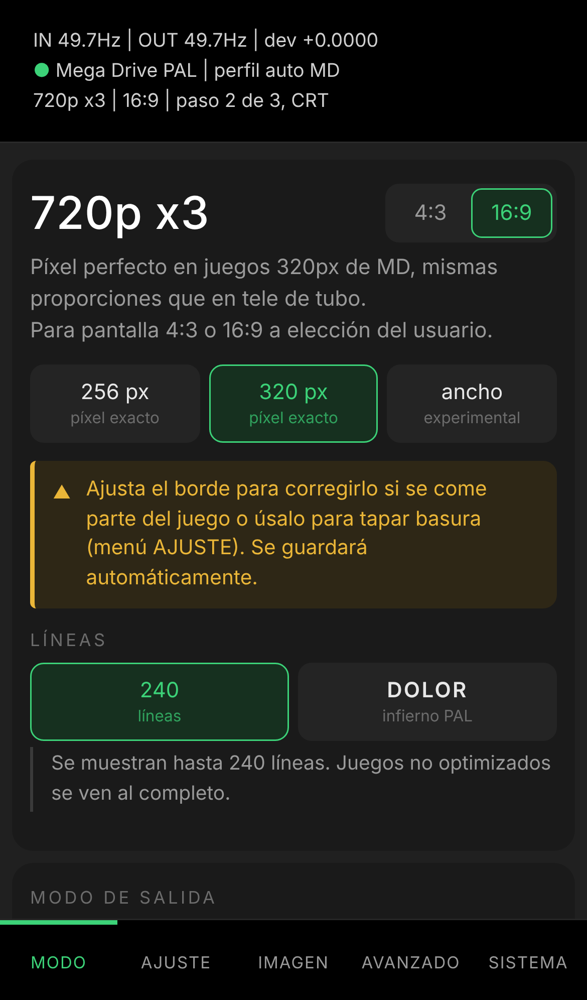
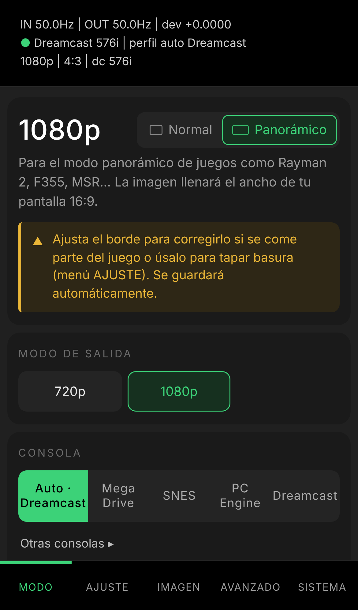
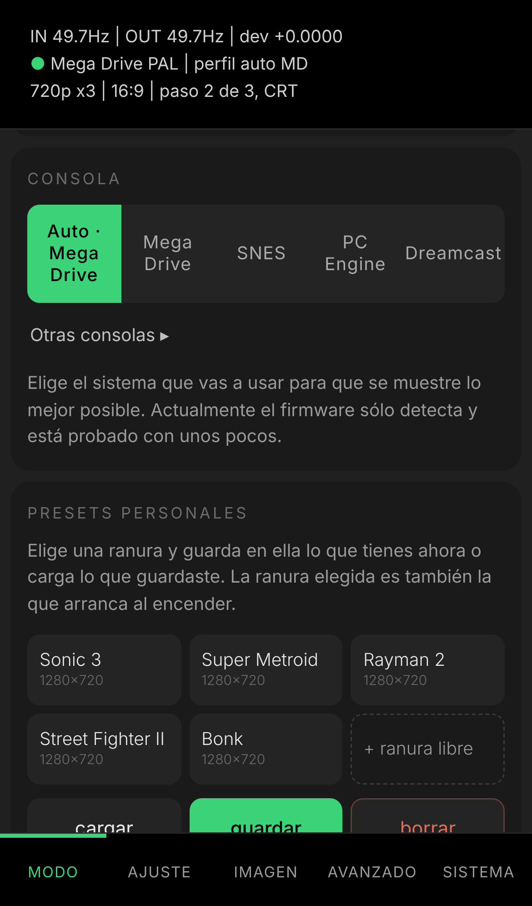
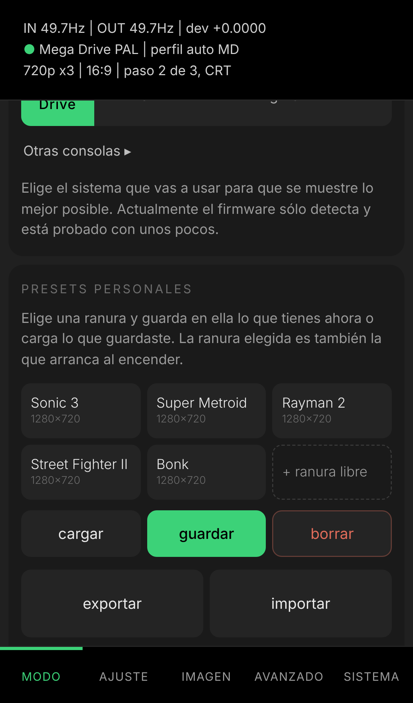
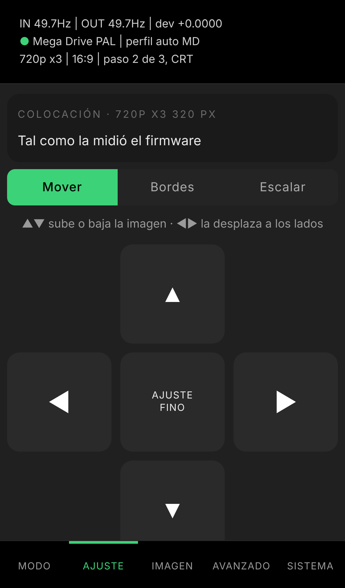
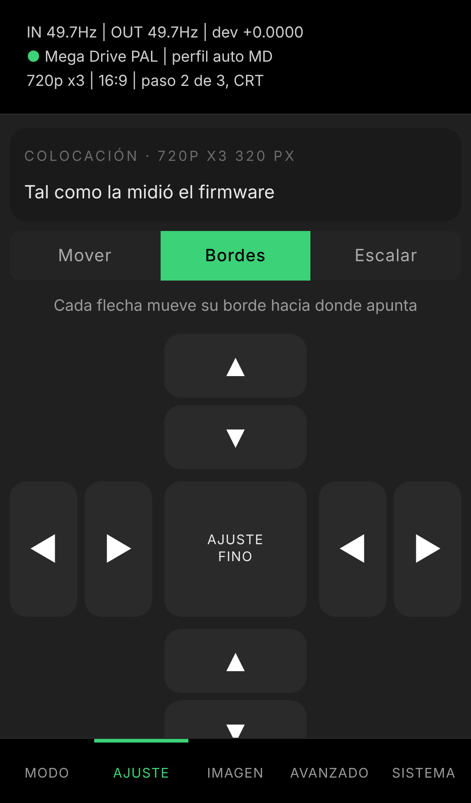
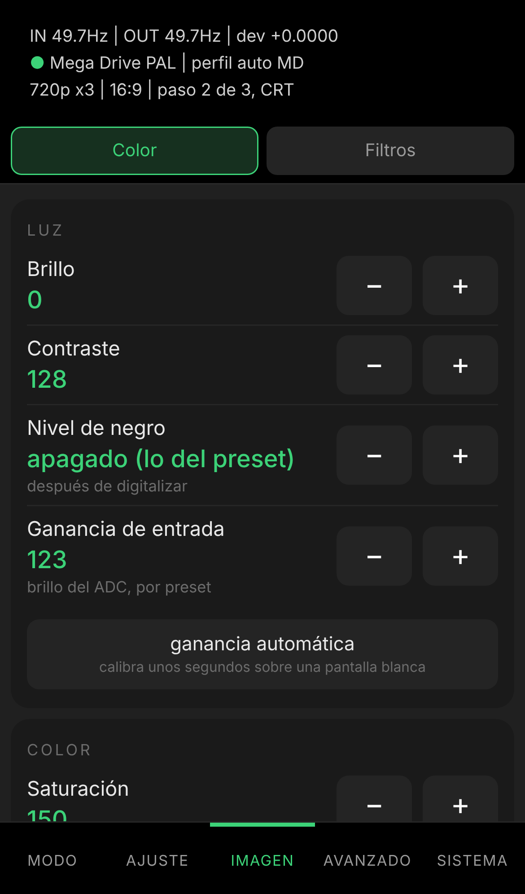
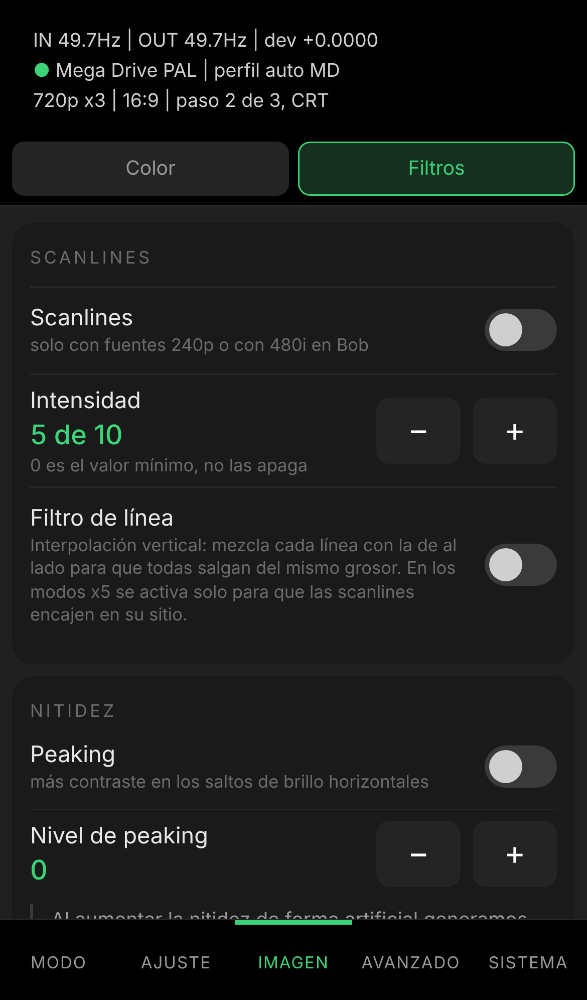
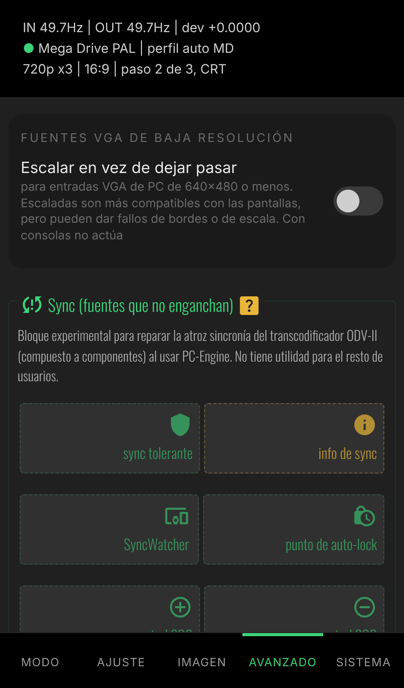

**Español** | [English](README.en.md)

# gbs-control-3X4X
<b>Firmware para GBS-Control con detección automática de consola, píxel entero y escalado vertical perfecto sin tocar nada.</b> 
  <i>Enciende, configura una sola vez y juega.</i>

<table align="center">
  <tr>
    <td></td>
    <td></td>
    <td></td>
  </tr>
  <tr>
    <td></td>
    <td></td>
    <td></td>
  </tr>
  <tr>
    <td></td>
    <td></td>
    <td></td>
  </tr>
</table>

## Índice

- [Objetivos del Firmware](#objetivos-del-firmware)
- [Muy importante](#muy-importante)
- [Instalación con Visual Studio Code](#instalación-con-visual-studio-code)
- [Sobre los modos experimentales](#sobre-los-modos-experimentales)
- [NOVEDADES DEL FIRMWARE 3X4X](#novedades-del-firmware-3x4x)
- [Método experimental para sincronías muy difíciles (ODV-II)](#método-experimental-para-sincronías-muy-difíciles-odv-ii)
- [Hardware probado hasta ahora y con perfil propio](#hardware-probado-hasta-ahora-y-con-perfil-propio)
- [Cómo ayudar para añadir nuevos sistemas](#cómo-ayudar-para-añadir-nuevos-sistemas)
- [Créditos](#créditos)

## Objetivos del firmware

El objetivo principal de este firmware es la detección de la consola conectada, cargando su perfil automáticamente sin la intervención del usuario, y procurando configuraciones de escalado vertical y píxel entero sin tocar nada. Esto permite encender, configurar una sola vez y jugar, con la capacidad de recordar tu configuración de cada sistema la próxima vez que vuelva a detectarse. Sencillo como nuestras consolas de los años 90, ¿no? Sin embargo, es un ambicioso propósito quizá imposible de alcanzar al 100% en todos los escenarios.

Actualmente el firmware es capaz de reconocer Mega Drive JAP (60hz), Mega Drive PAL (a 50hz o 60hz), Super Nintendo PAL (a 50hz o 60hz), Dreamcast PAL y PC-Engine (experimental*). Para ampliar el número de sistemas necesitaré colaboración de otros usuarios del GBS-Control. Información más abajo.

\* Mi PC-Engine no está modificada para RGB, sólo comprobada mediante un muy problemático ODV-II (transcodificador de compuesto a componentes). Más información en el texto que prosigue.

El segundo objetivo fundamental para mí era la posibilidad de alternar entre píxel entero y perfecto, o jugar con unas proporciones similares a como lo hacíamos en la época. Ya sabéis a qué me refiero, el eterno debate de si una Super Nintendo debería jugarse en el formato 4:3 de una tele antigua, o si es preferible respetar su píxel entero en 8:7. Que cada uno elija lo que le gusta, ¿no? Sólo hay que pulsar un botón, sin calcular nada, está escrito en el firmware.

El tercer objetivo era jugar a 1080p en anamórfico. Consolas de la llamada generación 128 tienen bastantes juegos en modo panorámico, incluso Dreamcast tiene unos cuantos como Rayman 2, F355, Metropolis Street Racer... Los dos modos de vídeo en los que me he centrado (más en el futuro, si Dios quiere), los habituales 720p y 1080p, ahora permiten jugar con una proporción de 4:3 o llenar la pantalla completa.

El cuarto objetivo imprescindible era la posibilidad de importar y exportar presets personalizados. Ahora podrás compartir con los amigos todas tus configuraciones favoritas con solo un par de toques, incluyendo los perfiles de color para cada consola.

Y un aspecto renovado. Bueno, y unas cuantas cosas más pero no vamos a eternizar esta introducción.

## Muy importante

El firmware 3X4X es una variante del firmware [gbs-control](https://github.com/ramapcsx2/gbs-control) de Rama, pero está basado en el gbs-control-nx de Kwakx. Me pareció interesante partir desde ahí porque su autor se centró en mejorar la estabilidad del Wi-Fi, uno de los problemas históricos más recordados de este dispositivo. De todas formas, a mí lo único que me funciona de verdad es desplazar mi red inalámbrica al canal 11. Un ejemplo sería el reloj de muestreo que uso en el "1080p 16:9 VGA" de Dreamcast, eso es infernal para el Wi-Fi; si no estoy en el canal 11, queda completamente anulado.

No puedo asegurar que este firmware funcione en versiones del GBS-Control distintas a la mía: GBS-8200, ESP8266 y reloj Si5351. Es indiferente que me detalles exactamente el hardware de tu escalador o si es una variante china rediseñada en una PCB mejor que la mía. No lo sé porque no puedo probarlo, tengo lo que tengo. Puedes ver mi GBS-Control en mi vídeo de YouTube sobre su construcción: [https://www.youtube.com/watch?v=-gFRIrJZsR8](https://www.youtube.com/watch?v=-gFRIrJZsR8)

El vídeo anterior es antiguo y probablemente desfasado, he aprendido unas cuantas cosas nuevas desde entonces.

Este firmware se instala mediante Visual Sudio Code o desde el apartado Update de la interfaz web (sólo si tu firmware ya estaba preparado para esta función). No puedo detallar mejor en este momento los pasos de instalación, busca en internet cómo instalar un proyecto PlatformIO o pídele ayuda a la IA.

## Instalación con Visual Studio Code

1. **Instala Visual Studio Code** (code.visualstudio.com) y, dentro de él, la extensión **PlatformIO IDE** desde el apartado de extensiones (el icono de los cuadraditos en la barra izquierda). Al terminar, reinicia Visual Studio Code.
2. **Descarga el proyecto:** en esta página de GitHub, botón verde «Code» › «Download ZIP». Descomprímelo en una carpeta sin caracteres raros en la ruta.
3. **Abre el proyecto:** en Visual Studio Code, «File» › «Open Folder» y elige la carpeta que contiene el archivo `platformio.ini`. La primera vez, PlatformIO descargará lo que necesita; puede tardar unos minutos.
4. **Conecta el ESP8266** al ordenador por USB. Si Windows no lo reconoce, instala el driver de su chip USB (normalmente CH340 o CP2102).
5. **Elige el idioma y sube el firmware:** abre el panel de PlatformIO (el icono de la hormiga en la barra izquierda) y, en «Project Tasks», despliega:
   - `gbsc` para la interfaz en **español**,
   - `gbsc_en` para la interfaz en **inglés**,

   y pulsa «Upload» dentro de ese entorno. No uses el botón «Upload» general de la barra inferior: sin un entorno elegido, PlatformIO compila y sube todos los del proyecto, uno detrás de otro.
6. Cuando termine, el GBS-Control se reinicia con el firmware nuevo.

**Actualizar desde la interfaz web** (si tu GBS-Control ya tiene un firmware con esta función): en el mismo panel, pulsa «Build» en lugar de «Upload». El archivo queda en `.pio/build/gbsc/firmware.bin` (o `.pio/build/gbsc_en/firmware.bin` para el inglés). Súbelo desde la pestaña Sistema › Actualizar firmware.

## Sobre los modos experimentales

Diversos modos del firmware se han marcado con la etiqueta "experimental", véase 720p x4, 720p x5 y 1080p x5. Están pensados como una función de ZOOM para aumentar el tamaño de juegos con ventanas reducidas y para accesorios como el Super Game Boy, pero me he topado con problemas técnicos, bien sea por limitaciones del TV5725 o aspectos que todavía no alcanzo a comprender (estoy en ello). Funcionan, pero pueden dar problemas según la combinación de reloj de la RAM y las diferencias entre placas. Úsalos sabiendo que no tienen el mismo nivel de pruebas que los dos principales, aunque tengo la intención de seguir intentándolo en el futuro.

## NOVEDADES DEL FIRMWARE 3X4X

Mismas funciones que el GBS-Control de Rama, más todas las que ves a continuación y alguna más que habré olvidado...

- Modos de salida 720p x3 (4:3 y 16:9) y 1080p x4 (4:3 y 16:9), y los modos que llamo experimentales 720p x4, 720p x5 y 1080p x5.

- Detección automática de la consola por la frecuencia de campo y la anchura del pulso de sincronía. Si falla, también se puede elegir el perfil a mano.

- **Perfiles por consola:** Mega Drive, SNES, PC Engine y Dreamcast ya tienen su propio perfil, con su colocación, sus anchos y sus ajustes. El resto de perfiles del firmware están en blanco, preparados para futuras versiones.

- **Distintos anchos por consola pensados para cada una de ellas:** botones de 256px, 320px, proporción CRT, panorámico... Estos botones no aparecerán todos al mismo tiempo, cada consola posee su conjunto único para obtener el píxel o ancho deseado.

- **Juegos PAL siempre a pantalla completa:** estos dos botones sólo aparecen si se detecta una fuente de vídeo PAL (excepto si es VGA).

- **240:** este botón muestra hasta 240 líneas con la proporción adecuada; los juegos adaptados a PAL se ven completos y también los que no (sean PAL o NTSC), todo bien grande.

- **DOLOR:** un botón para la experiencia europea «de verdad»: franjas, marcos de colorines y aplastamiento, como se veía en una tele PAL. Una broma, no pude evitarlo. Este modo no guarda ningún ajuste, no te molestes en toquetear nada. No disponible con VGA.

- **Presets personales:** se mantienen las ranuras para guardar, cargar y borrar un ajuste completo como en el GBS de Rama. La ranura elegida es la que arranca al encender, tal como funcionaba el original. Pero ahora...

- **Exportar e importar:** cada preset se guarda como archivo .gbsp y se puede importar a otro GBS con firmware 3X4X. Comparte tus ajustes con quien quieras. Importar nunca sobrescribe una ranura ocupada.

- **Resoluciones del GBS-Control original:** se mantienen los 1920×1080, 1280×1024, 1280×960, 1280×720, 480p / 576p, 15 kHz y Pass Through originales, para pantallas que no acepten los nuevos modos creados para este firmware o para aquellos usuarios que los consideran útiles. Si algo de lo que he creado no funciona bien, siempre tienes disponibles todas las funciones del GBS-Control original.

- **Nueva cruceta para mover imagen, bordes y escalar:** la opción para añadir bordes cuenta con una doble cruceta comodísima. Aprovecha para colocarlos bien y tapar porquería, nunca fue tan fácil.

- **Ajuste fino:** si lo activas, las acciones de mover, escalar y ajustar bordes avanzarán en pulsos más pequeños y precisos. Tendrás que dar más toques pero la colocación será exacta.

- **Botones para deshacer movimiento, borde y escala:** botones independientes para que unos ajustes equivocados no arruinen todo el preset.

- **Bordes guardados automáticamente:** el borde ajustado por el usuario se guarda cuando el firmware no detecta más retoques (unos 15 segundos) o si saltas rápidamente a otro modo. Cada consola y cada modo conservará sus bordes sin pisar el de ningún otro modo, consola o preset.

- **Bordes y ventana · ajuste rápido:** existe un segundo bloque de acciones para ajustar bordes que incluye valor de posición a la vista. Por mi parte, está en desuso desde que introduje la doble cruceta.

- **Lectura de memoria (MEM) vertical:** en el firmware original teníamos los dos botones de memoria horizontales, pero ahora también podemos tocar la memoria vertical. Estos botones corren la imagen dentro del lienzo ayudando a posicionarla sin basura en los laterales, ya que la basura se desplaza también.

- **Inicio de captura (IF HBIN):** desde qué punto de cada línea empieza a leer la señal.

- **Memoria (RAM):** velocidad de RAM y fase se ajustan de forma manual e independiente (si es necesario) para cada modo y ancho. A veces corrigen defectos en la imagen (glitches) y otras sólo la empeoran.

- **Nivel de negro:** nuevo botón de ajuste (experimental, tengo que probarlo bien).

- **Saturación:** nuevo botón de ajuste. Recomiendo darle de 5 a 20 toques por consola y guardar el preset de color. Esto le da mucha vidilla a la imagen sin manipular la TV, es la mejor opción, y recuerda que se guarda en el perfil de la consola que estés usando, no interfiere en las demás.

- **Matiz:** desplaza el color de 3 en 3 grados, y matiz a 0 para quitar el giro sin tocar la saturación. A mí me resulta útil porque tengo la sensación de que el ODV-II me tiñe de verde.

- Ganancia del azul (Pb/U) y del rojo (Pr/V) vienen ahora con su valor a la vista, son los valores que usaba cuando no existía botón de contraste. Los he mantenido pero prefiero usar el contraste.

- **Blanco y tinte:** balance de blancos por canal (R, G, B) y dos tintes, azul–amarillo y rojo–cian.

- **Negro de entrada (ADC):** el nivel de negro de los tres canales a la vez o de cada uno por separado, antes de digitalizar la señal. Útil cuando el negro llega muy subido (tirando a gris), por ejemplo con compuesto a través de algunos transcodificadores. (experimental, todavía tengo que probarlo bien, no estoy muy convencido)

- **Scanlines con más niveles:** la intensidad máxima total es la misma que en el firmware original, pero esta vez tenemos 11 niveles y botones − / + en lugar de un ciclo, así es más fácil dar con el punto justo.

- **Nitidez con más niveles:** en el original, peaking y respuesta de borde sólo se encendían o apagaban. Ahora cada uno tiene su propio nivel, que sube y baja de uno en uno, para afinar a tu gusto.

- Filtro de ruido de varios niveles antes de digitalizar la señal (experimental, hay que probar si realmente está haciendo algo, diría que con fuentes 240p esto ni se nota, no lo sé)

- **Muestreo del ADC:** fase manual o automática para escoger la imagen más nítida y con menos tembleque.

- **Guardar, cargar, exportar y reiniciar "Color y Filtros":** los ajustes de color y filtros (se almacenan juntos) se configuran consola a consola, lo que toques en Mega Drive no altera Super Nintendo. Además... cada perfil de color y filtro se exporta en su propio archivo (color-mega-drive.gbsc, color-pc-engine.gbsc…). Quien lo importe lo recibirá directamente en esa consola, aunque en ese momento tenga otra conectada, no se pisan, no interfieren.

- **Sync para fuentes que no enganchan:** el método experimental que se explica más abajo.

- **Frecuencia de salida:** seguir a la fuente o fijarla en 59,94 / 60,00 Hz para dispositivos (muchas capturadoras) que no aceptan frecuencias exóticas noventeras. Esto sustituye al antiguo botón de «forzar PAL 50 Hz a 60 Hz» y no requiere reinicio.

- **Actualizar firmware desde la web:** se sube el firmware.bin ya compilado desde el navegador.

- Interfaz rediseñada por completo con cinco pestañas principales: Modo, Ajuste, Imagen (subpestañas: Color y Filtros), Avanzado y Sistema.

- **Barra de estado siempre visible:** frecuencia de entrada y salida, consola detectada, modo y ancho.

- **Diagnóstico con un botón:** copia al portapapeles los tiempos de vídeo y el log para compartirlos.

- **Huella de la consola:** copia al portapapeles las características de la señal (frecuencia, líneas, pulso de sync) para identificar consolas nuevas. Este botón permitirá añadir nuevas consolas que yo no poseo gracias a las mediciones de quien desee colaborar.

- **Ningún control queda «a ciegas»:** cada botón de la interfaz muestra su valor numérico o estado para que sepas qué estás haciendo sin abrir logs de desarrollo.

- Interfaz en español o inglés según el firmware que uses. La versión inglesa es una traducción de IA sin mi intervención, es la única manera de sacar esto adelante.

- **Valores de fábrica:** ahora borran todo lo que ha ajustado el usuario (color, bordes, sync, último modo de cada consola) y después preguntan si también deseas borrar los presets personales.

Ya no sé si me dejo algo o no, a estas alturas estoy delirando, esto empieza a ser mucho más grande de lo que ideé al principio, sólo espero que os guste. He mimado cada detalle y comportamiento lógico de este firmware, dándole vueltas a cosas en las que jamás antes había pensado (en serio, Rama, Mike Chi y todos los involucrados en estos temas, tenéis mi eterna gratitud y respeto). De verdad, ojalá os guste.

## Método experimental para sincronías muy difíciles (ODV-II)

La PC-Engine por vídeo compuesto, convertida a componentes con un transcodificador ODV-II, llega al GBS con una sincronía atroz: la imagen da saltos cada dos segundos y el firmware original no consigue estabilizarla nunca. Contacté con el fabricante del ODV, pero me dio la impresión de que la persona al otro lado se limitó a leer las características y repetírmelas...

Revisando todas las opciones del GBS-Control, recurrí a mi viejo amigo SyncWatcher para hacer un apaño: deteniéndolo en el momento exacto podía obtener una imagen casi perfecta (salvo por unas pocas líneas mal posicionadas). Para que mi proceso manual a base de insistir se simplifique y acelere enormemente, he desarrollado, con la inestimable ayuda de Claude, un método que automatiza mi idea original: detener el vigilante en el momento preciso en el que hay una sincronía aceptable, capturar dicha sincronía y guardarla como preset.

¿Podría servir para otras consolas imposibles de sincronizar con ODV-II + GBS-C? Es muy probable que sí.

- **Estado de sync guardable por consola:** cuando por un instante la imagen se vea bien (o casi), antes de que vuelva a saltar y corromperse en un bucle infinito, el botón capturar sync sirve para guardar ese estado estable (nivel SOG, coast, pulse ignore, fase…). Desde ese momento, dicho estado se vuelve a cargar automáticamente sólo en el perfil de la consola problemática. La imagen se estabilizará sin intervención. Si se estabiliza con errores pulsa cargar sync varias veces.
- **Auto-reintento:** el firmware suelta y vuelve a enganchar la señal cada pocos segundos; sólo hay que mirar y pulsar "capturar sync" en uno de esos instantes aleatorios en los que la imagen salga brevemente bien posicionada.
- **Auto-lock:** detiene el vigilante de sincronía (SyncWatcher) en cuanto la imagen se lee estable para que no la vuelva a romper.
- **Receta ODV:** un estado medido por mí que funcionó con mi PC Engine, como punto de partida.
- **Sync tolerante:** los cortes de sincronía breves congelan la imagen en vez de provocar un gran salto.
- **Protección del estado guardado:** mientras está en uso, la recuperación automática no sobrescribe los valores que lo hacen funcionar, y FrameTime Lock, la frecuencia de salida y la barra de estado siguen trabajando con el vigilante parado.

Nada de lo anterior afecta a consolas que funcionen correctamente, no interferirá en otros perfiles, sólo en el que tengas activado. Por favor, no confundas preset con perfil. El preset son los modos de vídeo incluidos en el escalador o creados por ti, el perfil se refiere al listado de consolas disponible.

## Hardware probado hasta ahora y con perfil propio

- Mega Drive PAL y Mega Drive japonesa con conmutador 50/60 Hz. RGB.
- SNES PAL con conmutador 50/60 Hz. RGB.
- PC Engine a través de un transcodificador ODV-II. Vídeo compuesto.
- Dreamcast PAL. Todos los modos probados. RGB y VGA.
- GBS-Control casero, como el de Voultar y el de mis vídeos.

Las consolas del listado superior han sido probadas a fondo pero el número de escenarios y modos es abrumador. Ten paciencia si algo falla, sólo soy una persona, la IA me asiste para introducir cambios en el firmware, pero soy yo quien mide consola por consola, ajusta píxel a píxel, pasa por todos los modos y resoluciones, y decide. Soy usuario fiel y asiduo del GBS, lo mejoraré aunque sólo lo use yo y esto no tenga ni una sola descarga, pero me lo tengo que tomar con calma.

Cualquier consola que no tenga su perfil finalizado (la interfaz te avisará de su estado), estará usando un perfil vacío, sin mediciones.

Quizá la huella que uso para detectar mis consolas sea distinta a la tuya, llega el momento de la verdad. Te pido que estés siempre atento a la barra de estado, si la autodetección no funciona, tendrás que elegir tú. Y te recuerdo que los perfiles de Rama siguen disponibles, los tienes al final de la primera pestaña.

## Cómo ayudar para añadir nuevos sistemas

Cuando finalice de medir los sistemas a mi alcance, actualizaré solicitando la ayuda de la comunidad. Aquellos de vosotros que sepáis calcular el píxel perfecto y proporciones adecuadas, podréis hacerme llegar vuestras huellas (características de la señal de vídeo para diferenciarla de otras) y timings (posicionamiento y tamaño de la imagen). Paciencia, damas y caballeros. Actualizaré tan pronto como pueda.

## Créditos

- **Rama (ramapcsx2/gbs-control):** el firmware original.
- **Kwakx (gbs-control-nx):** la base de esta rama.
- **Artemio:** su 240p Test Suite, sin la que este firmware habría sido imposible.
- **Alexei:** ¡yo mismo! 4lexei.com
